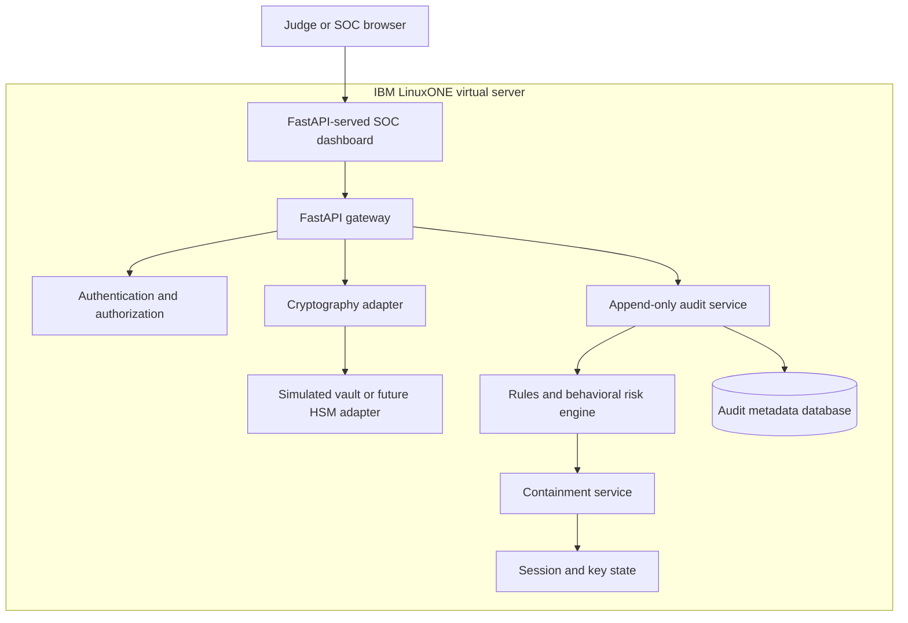

# Architecture

## Objective

Provide quantum-safe key operations while detecting and containing suspicious
administrator behavior in real time.

## Deployment view



## Component responsibilities

| Component | Responsibility |
|---|---|
| FastAPI gateway | Validates requests and coordinates protected operations |
| Authentication | Identifies the caller and manages sessions |
| Authorization/policy | Enforces role and non-negotiable security rules |
| Cryptography adapter | ML-KEM, ML-DSA, and AES-GCM operations |
| Vault adapter | Creates, uses, locks, rotates, and revokes keys without exporting them |
| Audit service | Emits structured append-only metadata for every operation |
| Risk engine | Combines rule violations and behavioral anomaly signals |
| Response service | Revokes sessions, locks keys, preserves evidence, and raises alerts |
| Dashboard | Shows normal flow, attack flow, explanations, metrics, and system state |

The dashboard is served by the FastAPI process at `/dashboard`, so the judged
system requires only one localhost service and one SSH tunnel. Its JavaScript calls
the same protected endpoints as any other client. Tokens live only in page memory;
the authenticated `/dashboard/snapshot` endpoint returns a bounded, user-scoped,
secret-free view of keys, sessions, alerts, platform facts, and audit events.

Authentication uses a one-time local admin bootstrap, PBKDF2-SHA256 password hashes,
and short-lived opaque bearer tokens whose SHA-256 digests are stored in SQLite.
There is no public bootstrap route and no default password.

## LinuxONE usage

The final prototype runs all server-side components on one LinuxONE VM. Development
may occur on team laptops, but the judged demonstration executes on LinuxONE. The
browser is only a client. Crypto Express is optional and must not be claimed unless
the provisioned environment exposes compatible access.

### Verified target environment

- Architecture: `s390x`
- Operating system: Ubuntu 24.04.5 LTS
- Compute: 3 vCPUs and 7.8 GiB RAM
- Storage: 50 GiB root disk with approximately 45 GiB initially free
- Runtime available at provisioning: Python 3.12.3 and Git 2.43.0
- Initial network exposure: SSH only
- Installed build baseline: GCC/G++, CMake, Ninja, Python headers, OpenSSL headers,
  venv, pip, and pkg-config
- Verified application location: `/home/linux1/quantum-keyguard`
- Verified access pattern: FastAPI bound to `127.0.0.1`; health request returned 200
- Managed runtime: enabled `quantum-keyguard.service`, unprivileged `linux1`,
  restart-on-failure, systemd sandbox exposure score `4.4 OK`
- Network boundary: only SSH is public; dashboard/API port 8000 is loopback-only
- Runtime permissions: `runtime/` mode `0700`, SQLite database mode `0600`

## Data stores

- SQLite for users, sessions, keys, policies, alerts, and audit metadata. Audit rows
  have database triggers that reject update and delete operations.
- SQLite state for sessions, key lifecycle metadata, alerts, and token digests.
- Process memory for native secret-key handlers; active metadata is revoked on every
  application restart because those handlers are intentionally non-persistent.
- JSON Lines for generated raw audit events.
- Model artifact plus vocabulary and threshold files for behavioral inference.

### Generated dataset boundary

The V2 generator writes event-level `audit_events.jsonl` and sequence-level
`sessions.jsonl`: 21,000 normal and 9,000 anomalous sessions spanning nine attack
families. Users are split-disjoint. The next-action objective learns only from normal
training steps; a second contextual attack head learns known attack progressions.
Validation and test sessions remain held out.

Dataset V2 was generated independently on Windows/Python 3.11 and
LinuxONE/Python 3.12 with byte-identical event, session, and summary hashes.

## Behavioral model deployment

PyTorch trains a contextual multi-task LSTM on the laptop because no PyTorch package
is available for the provided s390x VM. Inputs combine previous-action, role,
algorithm and previous-outcome embeddings with cyclical hour, time gap, device,
recent-failure and sequence-position values. One head predicts the next action; a
second estimates known attack progression. The exported versioned JSON model runs
through a standard-library implementation of the same equations on LinuxONE. Live
events therefore remain on LinuxONE during inference. The exported V2 runtime
matches PyTorch within approximately 0.00000035 and averages approximately 10.64 ms
per complete test session on the provisioned LinuxONE VM.

## Quantum-safe runtime boundary

LinuxONE runs a native, minimal liboqs 0.16.0 build containing ML-KEM-768 and
ML-DSA-65. `OQSVault` retains native secret-key handlers in the server process and
exposes operations rather than raw private keys. ML-KEM establishes a shared secret;
HKDF-SHA256 derives an AES-256 key; AES-GCM protects the payload and associated
context. ML-DSA signs and verifies messages.

This prototype uses software-backed liboqs on LinuxONE. It does not claim Crypto
Express or hardware-backed private-key storage. The vault boundary is intentionally
replaceable by a future PKCS #11 adapter if compatible access is provided.

The service fails closed on restart: metadata for any previously active
process-memory key is changed to revoked before requests are accepted. This prevents
the database from claiming that missing private material is usable.

## Audit trust boundary

Only validated metadata crosses into audit storage. Audit context recursively rejects
field names associated with private keys, secrets, seeds, passwords, tokens,
credentials, and plaintext. The application exposes append and chronological-read
operations only; SQLite independently blocks row updates and deletes.

## Policy precedence

```text
Inactive session or key -> DENY
Always-forbidden operation -> CONTAIN
Unapproved RSA-1024 request -> CONTAIN
Role lacks permission -> DENY
High behavioral risk -> CHALLENGE
New device outside normal hours -> CHALLENGE
Otherwise -> ALLOW
```

Containment performs session revocation, optional key locking, critical-alert
creation, and response-audit insertion in one SQLite transaction.

## Implemented protected-operation boundary

Only an `ALLOW` decision invokes the vault callback. `CHALLENGE` and `DENY` are
audited without execution. `CONTAIN` additionally revokes the session, locks the
managed-key record, creates an alert, and writes response evidence. API responses may
return public keys, signatures, KEM ciphertext, and AES-GCM sealed payloads; they
never return private keys, shared secrets, or the plaintext supplied to `/protect`.

