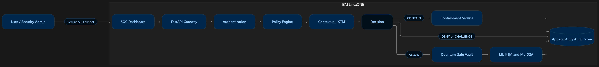
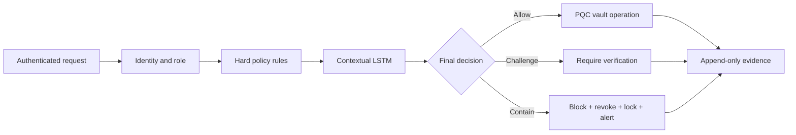
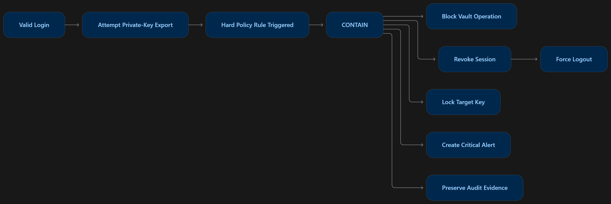
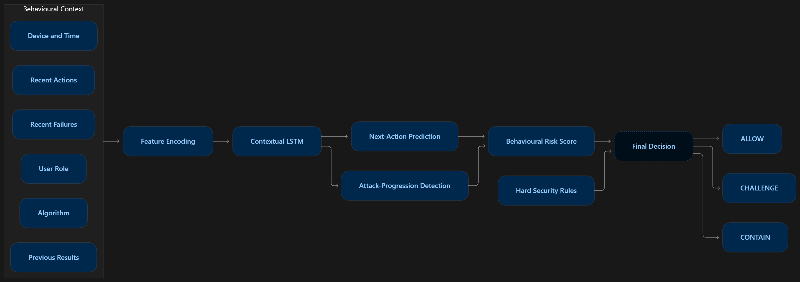
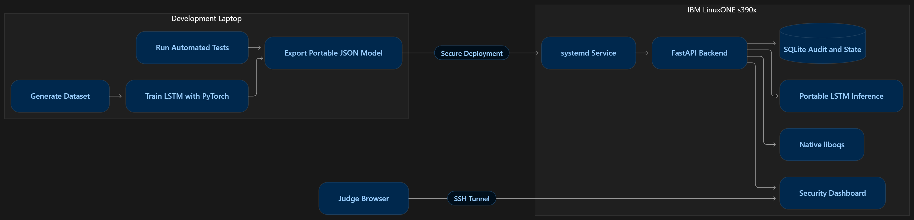

# Quantum-Safe KeyGuard

### Team Chaturvyuha | IBM Z Datathon 2026

**Theme:** Real-Time AI for Critical Decisions

> A pre-execution security control that combines contextual behaviour analysis,
> deterministic policy and post-quantum cryptography to stop dangerous key
> operations before private key material can be used or exposed.




## The problem

Organizations are moving toward post-quantum algorithms, but replacing vulnerable
cryptography is only part of the problem. A valid account, stolen session or
malicious administrator can still request a dangerous key operation.

Traditional controls often act too late:

- Role-based access checks whether an operation is permitted, not whether the
  sequence of behaviour is suspicious.
- SIEM tools commonly alert after the sensitive action has already executed.
- Cryptographic libraries protect algorithms but do not understand user context.
- Manual incident response leaves a gap between detection and containment.

The critical decision must happen **before** a private key operation executes.

## Our solution

Quantum-Safe KeyGuard places one decision boundary in front of every sensitive key
operation:

1. **Identity** validates the user, role, session and device.
2. **Policy** applies non-negotiable authorization and security rules.
3. **Contextual LSTM** evaluates the ordered behaviour and live session context.
4. **PQC vault** performs approved ML-KEM and ML-DSA operations without exporting
   private keys.
5. **Automated containment** blocks the request, revokes the session, locks the key,
   raises an alert and preserves evidence when a threat is detected.

Hard security rules always remain the final authority. AI can increase protection,
but it can never override a deterministic denial.



## What the demonstration proves

### Normal journey

An authorized administrator creates ML-DSA and ML-KEM keys, signs and verifies a
record, and protects a payload. The operation passes policy and behavioural checks,
executes inside the vault boundary and is written to the audit timeline.


### Rogue journey

A user with a valid session attempts to export a private key. The request reaches
policy and AI scoring but **never reaches the vault operation**. KeyGuard atomically:

- blocks the attempted operation;
- revokes the active session;
- locks the targeted key;
- creates a critical alert; and
- records correlated, append-only incident evidence.



## AI-based rogue action detection

The contextual multi-task LSTM does not examine secret key material or plaintext.
It evaluates security metadata and ordered activity:

- recent action sequence;
- user role and requested algorithm;
- device familiarity and login hour;
- previous outcome and time gap;
- recent failures and sequence position.

The model produces next-action surprise and attack-progression scores, which are
combined into an explainable behavioural risk value. The exported JSON model is
executed by a portable standard-library inference runtime on LinuxONE s390x.



### Dataset and evaluation

| Item | Prototype evidence |
|---|---:|
| Synthetic sessions | 30,000 |
| Normal sessions | 21,000 |
| Attack sessions | 9,000 across nine attack families |
| Held-out test results | 1,800 TP / 3,150 TN / 0 FP / 0 FN |
| LinuxONE average inference | 10.64 ms per complete test session |

The perfect holdout result is reported as **controlled synthetic prototype
evidence**, not as a claim of production accuracy. Real enterprise telemetry and
human-reviewed feedback are required before production deployment.

## Why IBM LinuxONE

The browser is only the client. The security-sensitive path runs together on one
IBM LinuxONE Community Cloud VM:

- FastAPI authentication and protected-operation gateway;
- portable contextual LSTM inference;
- native software-backed liboqs 0.16.0 on s390x;
- ML-KEM-768 and ML-DSA-65 operations;
- automated response and append-only SQLite evidence;
- dependency-free SOC dashboard served by the same process.

The service runs unprivileged under systemd, binds only to `127.0.0.1:8000`, and is
accessed through an SSH tunnel. This keeps the judged prototype private while still
demonstrating that inference, cryptography, response and evidence execute on
LinuxONE.

### Measured on the provisioned LinuxONE VM

| Operation | Average latency |
|---|---:|
| ML-DSA-65 signing | 1.126 ms |
| ML-KEM-768 round trip | 0.211 ms |
| Atomic containment | 2.435 ms |
| Contextual LSTM test session | 10.64 ms |

See [Architecture.md](Architecture.md) for the detailed component and trust-boundary
design.

## Technology stack

| Layer | Technology |
|---|---|
| Dashboard | HTML, CSS, JavaScript |
| API and validation | Python 3.12, FastAPI, Pydantic |
| Behaviour model | PyTorch training, portable JSON LSTM inference |
| Cryptography | liboqs, ML-KEM-768, ML-DSA-65, HKDF-SHA256, AES-256-GCM |
| State and evidence | SQLite with append-only audit enforcement |
| Platform | IBM LinuxONE s390x, Ubuntu 24.04, systemd |

No paid API, external AI service or commercial dataset is required.

## Implementation status



- 45 tests passed on LinuxONE, including native cryptography and containment tests.
- Dashboard and health endpoints returned HTTP 200 on the deployed service.
- The systemd service was active with restart-on-failure and restricted permissions.
- Native ML-KEM-768 and ML-DSA-65 operations were benchmarked on s390x.

## Run locally

```powershell
git clone https://github.com/manish-athith/quantum-safe-keyguard.git
cd quantum-safe-keyguard
python -m venv .venv
.\.venv\Scripts\Activate.ps1
python -m pip install -r requirements.txt
$env:PYTHONPATH = "src"
python -m quantum_keyguard.bootstrap_admin
python -m uvicorn quantum_keyguard.main:app --app-dir src --host 127.0.0.1 --port 8000
```

Open:

- Dashboard: `http://127.0.0.1:8000/dashboard`
- API evidence: `http://127.0.0.1:8000/docs`
- Health check: `http://127.0.0.1:8000/health`

The bootstrap command securely prompts for a password of at least 12 characters.
There is no embedded demo password or public bootstrap endpoint.

## Run on IBM LinuxONE

Build the pinned native liboqs runtime and install the service:

```bash
cd ~/quantum-keyguard
./scripts/build_liboqs_linuxone.sh
./scripts/install_linuxone_service.sh
systemctl status quantum-keyguard.service --no-pager
```

Create an SSH tunnel from the client machine:

```powershell
ssh -N -i "C:\path\to\linuxone-key.pem" -L 8000:127.0.0.1:8000 linux1@LINUXONE_IP
```

Never commit or share the `.pem` file.

## Repository structure

```text
src/quantum_keyguard/
  api/             Authenticated API and dashboard endpoints
  crypto/          PQC vault adapter and payload protection
  dataset/         Reproducible synthetic security-event generator
  detection/       LSTM training, evaluation and portable inference
  persistence/     SQLite state and append-only evidence repositories
  services/        Policy, protected operation and containment services
  web/             Dependency-free SOC dashboard
tests/              Security, model, API and end-to-end tests
scripts/            LinuxONE build, deployment, backup and benchmark tools
deploy/             Hardened systemd service definition
artifacts/          Exported portable LSTM model
evidence/           LinuxONE runtime and benchmark evidence
```

## Security and scope boundaries

- Raw private keys, shared secrets, passwords and bearer tokens are never logged.
- The API never returns private-key material.
- The audit store rejects updates and deletions at the database layer.
- Containment state and evidence commit in one transaction.
- The prototype vault is software-backed and process-memory-only.
- We do **not** claim Crypto Express, HSM-backed storage or production detection
  accuracy.

## Team

**Chaturvyuha**

Built for IBM Z Datathon 2026 to protect both the cryptographic algorithm and the
human behaviour surrounding every sensitive key operation.
